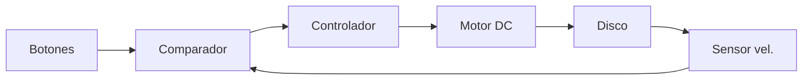

**Instituto Tecnológico de Costa Rica**  
Escuela de Ingeniería en Computadores  
CE 1110 — Análisis de Señales Mixtas

---

# Proyecto Grupal 2

## Diseño de un sistema de control de frenado de ABS

---

| | | | |
|---:|:---|---:|:---|
| **Fecha de asignación:** | 11 noviembre 2026 | **Fecha de entrega:** | 2 diciembre 2026 |
| **Grupos:** | 3-4 personas | **Profesores:** | Luis Chavarría Zamora |

Mediante el desarrollo de este proyecto, el estudiante aplicará los conceptos de análisis de señales mixtas. Atributos relacionados: **A**nálisis de **P**roblemas (AP).

## 1. Descripción general del proyecto

Cada grupo diseñará y construirá un **banco de frenado de una rueda o disco** accionado por un motor de corriente directa (CD), con un mecanismo de frenado controlado electrónicamente. El objetivo principal es **regular la velocidad angular del disco durante una maniobra de frenado mediante un controlador PID digital**, partiendo de un modelo experimental de la planta.

La construcción mecánica será libre y deberá privilegiar soluciones sencillas, económicas y reproducibles. Se permiten cartón, madera liviana, piezas reutilizadas, goma, impresión 3D y otros materiales disponibles. **No se exige construir un automóvil, suspensión, transmisión ni sistema hidráulico.** El mecanismo puede consistir en un servomotor que presiona una zapata de goma contra el disco. Se permite otra solución acordada previamente con el profesor. El sistema completo a nivel de bloques se visualiza en la Figura 1.

El sistema deberá incluir:

1. **Disco o rueda:** elemento rotatorio visible y firmemente sujeto al eje.
2. **Motor CD:** proporciona movimiento al disco antes de cada prueba; su alimentación debe poder reducirse o desconectarse de manera controlada.
3. **Freno accionado:** servomotor u otro actuador que aplica presión o fricción variable sobre el disco.



*Figura 1: Propuesta de diseño para sistema de control.*

4. **Sensor de velocidad angular:** encoder, sensor óptico, Hall u otra alternativa validada; deberá permitir registrar la velocidad en función del tiempo.
5. **Microcontrolador:** ejecuta la adquisición de datos y el controlador PID discreto.
6. **Referencia y registro:** mecanismo para definir una consigna de velocidad y guardar los datos de las pruebas.

La construcción de la planta es libre y a conveniencia del grupo de trabajo. El freno es un **actuador unilateral**: puede desacelerar, pero no acelerar directamente el disco. Por tanto, las referencias deberán ser físicamente alcanzables (por ejemplo, trayectorias de velocidad decrecientes), y el controlador deberá considerar saturación y evitar acumulación excesiva del término integral. No se exige mantener una velocidad positiva constante después de que el disco haya perdido energía.

> **Alcance:** este montaje representa un banco didáctico de frenado realimentado. No constituye un ABS automotriz completo, ya que para calcular el deslizamiento rueda–vehículo se requiere además una estimación de la velocidad longitudinal del vehículo. La función antibloqueo se plantea como mejora opcional, bajo las limitaciones descritas en los puntos extra.

## 2. Especificación

Este proyecto se desarrollará en las siguientes etapas donde se ofrece una guía para desarrollar el documento técnico y la parte funcional del proyecto (generará un controlador digital, tome en cuenta el muestreo):

1. Revisión literaria: El estudiante realizará una revisión exhaustiva de la literatura sobre controladores, modelado de sistemas físicos, respuesta al escalón. Identificará conceptos clave, algoritmos existentes y su relevancia en sistemas de control. La información recabada no será de más de una página (no incluye referencias dentro de esa página, formaría parte de la sección de referencias). Además Investigar modelado de sistemas rotacionales, fricción y frenado, identificación experimental, respuesta al escalón y control PID digital. Explicar las limitaciones de un modelo lineal alrededor de un punto de operación.

2. Construcción de la planta: Construir y mostrar el banco con disco, motor, sensor y freno. Verificar que se puede iniciar el disco a una velocidad repetible y modificar la intensidad de frenado. *Entregables:* planta funcional, descripción de materiales, esquema eléctrico y registro de velocidad.

3. Extracción del modelo físico: Diseñar experimentos a lazo abierto aplicando entradas conocidas al actuador de frenado desde condiciones iniciales controladas. Registrar *u(t)* y *ω(t)*; considerar el retardo del servo, fricción, zona muerta y saturación. Identificar un modelo aproximado de la relación entre acción de frenado y velocidad angular o desaceleración, especificando claramente las condiciones de validez. No se debe suponer que la planta es lineal en todo su recorrido. *Entregables:* datos experimentales, modelo matemático o función de transferencia local, validación frente a datos no utilizados en el ajuste, polos y ceros cuando corresponda, y frecuencia de muestreo justificada.

4. Diseño de controlador digital: Diseñar e implementar un controlador PID que siga una trayectoria de velocidad angular decreciente durante el frenado. Justificar el diseño mediante análisis en Laplace y/o transformada Z, y explicar la discretización empleada. Considerar límites físicos del freno, ruido de medición y protección contra saturación integral (anti-windup). *Entregables:* ecuación de control, parámetros iniciales, periodo de muestreo y análisis de polos y ceros del controlador y del lazo cerrado según el modelo obtenido.

5. Experimentos de ajuste para el controlador: Ajustar *Kp*, *Ki* y *Kd* experimentalmente, documentando las modificaciones y su efecto sobre el desempeño. Se permite que algún coeficiente resulte cero si existe una justificación técnica, pero debe demostrarse el estudio de los tres términos. *Entregables:* ganancias finales, criterios de ajuste y gráficas de pruebas intermedias.

6. Experimentos finales: Comparar, bajo condiciones iniciales equivalentes, **(a)** frenado a lazo abierto con acción fija y **(b)** frenado con PID siguiendo una referencia temporal especificada. Realizar al menos tres repeticiones por condición y dos velocidades iniciales diferentes. Registrar referencia, velocidad medida, error y acción de control. Comparar error de seguimiento (por ejemplo IAE o RMSE), tiempo de frenado, oscilaciones, saturación y variabilidad entre ensayos. Explicar por qué una menor duración de frenado no demuestra, por sí sola, un mejor ABS.

## 3. Requerimientos mínimos de funcionamiento

El prototipo debe demostrar en vivo: (1) giro estable del disco y medición de velocidad; (2) frenado controlable por el actuador; (3) adquisición y registro de señales; (4) ejecución real del PID digital; (5) seguimiento de al menos una referencia decreciente físicamente realizable; (6) comparación experimental de lazo abierto y cerrado; y (7) capacidad de explicar el modelo, la selección del muestreo y los parámetros PID. El grupo deberá proteger las partes móviles, fijar el disco y limitar la velocidad a un nivel seguro.

## 4. Puntos extra opcionales

Se podrá obtener una bonificación máxima de **15 puntos porcentuales sobre la nota del proyecto en su parte funcional**. Los puntos extra solo se asignarán con demostración funcional, datos y análisis; no reemplazan los requisitos básicos. **Estos puntos extra solo se habilitan si funciona lo básico y mínimo. Los estudiantes deben mostrar escenarios donde evidentemente el funcionamiento de estas características.**

1. **Lógica antibloqueo simplificada (hasta 5 puntos):** detectar una caída anormal de velocidad o desaceleración y liberar/modular temporalmente el freno, con umbrales justificados y pruebas comparativas. Debe denominarse *antibloqueo simplificado* y no medición de deslizamiento vehicular.
2. **Comparación de discretizaciones o periodos de muestreo (hasta 3 puntos):** implementar dos configuraciones, justificar sus diferencias y comparar estabilidad y desempeño experimental.
3. **Control por regiones de operación (hasta 3 puntos):** usar ganancias distintas según la velocidad o un esquema sencillo de *gain scheduling*, con resultados comparativos.
4. **Rechazo de perturbaciones (hasta 2 puntos):** aplicar una perturbación reproducible, segura y medible (por ejemplo, un cambio de rozamiento o inercia) y evaluar la recuperación del control.
5. **Identificación semiautomática (hasta 2 puntos):** automatizar la adquisición y el ajuste de parámetros del modelo y validar la predicción sobre datos nuevos.

## 5. Metodología de trabajo

El proyecto debe seguir los siguientes aspectos de desarrollo colaborativo en git, sino, la parte funcional no será calificada y obtendrá nota de cero:

1. Utilice una cuenta de repositorio gratuita.
2. Cree un repositorio con el siguiente nombre: `<user id>_asm_2026_s1`. El `user id` estará compuesto por la primera letra del nombre y el apellido que haga el repostorio. Por ejemplo, para el estudiante Luis Chavarría, el nombre del repositorio será: `lchavarria_asm_2026_s1`. **Se usará un repositorio por grupo**, le realiza la invitación a las demás personas.
3. Si el repositorio es privado, proporcione acceso a `luchazam` (bitbucket) o `luchazam` (GitHub).
4. El repositorio de Git contendrá dos ramas principales: `master` y `development`.
5. Inicialmente, la rama de `development` se crea a partir del `master`.
6. Al trabajar en un proyecto, el estudiante debe crear una nueva rama de trabajo desde `develop` y cuando la función esté lista, la rama debe fusionarse para `develop`. Cualquier corrección o modificación adicional después de `merge` debería requerir que se repita el proceso (es decir, crear la rama desde `develop` y fusionar los cambios más tarde). Una vez que el código de desarrollo esté listo, se fusionará con `master` y se debe crear una `tag`. El proceso se describe en la siguiente Figura 2.

   

   *Figura 2: Git workflow*

   Adicionalmente se coloca este [enlace](https://nvie.com/posts/a-successful-git-branching-model/) recomendado.

7. Después de haber realizado algunos proyectos la rama `master` debe verse así:

   ```
   master/
     • proyecto 1
     • proyecto 2
     • ···
   ···
   ```

   Donde cada directorio de `proyecto x` contiene todos los entregables para cada proyecto. **No es permitido realizar todo el trabajo en un solo commit, es decir, que realice el trabajo de forma local y solo suba el último entregable en el repositorio. Si no, obtendrá nota de cero. Debe mostrar avance incremental durante todas las semanas (se revisarán estadísticas). Se revisará el trabajo en equipo.**

## 6. Evaluación y entregables

La defensa será el mismo día de la entrega y todos los archivos (incluyendo código fuente) serán entregados a las 11:50 pm ese mismo día (realícenlo progresivamente y no lo dejen para el final). **Si algo no queda claro o no sabe, no lo asuma, pregúntele al profesor.** Como recomendación se presenta el cronograma de trabajo de la Tabla 1.

*Tabla 1: Cronograma sugerido para el proyecto*

| Semana | Actividades sugeridas |
|:---:|:---|
| 1 | Realizar sección 1 y 2. |
| 2 | Realizar sección 3. |
| 3 | Realizar sección 4 y 5. |
| 4 | Realizar sección 6. |

La evaluación del proyecto se da bajos los siguientes rubros contra rúbrica correspondiente:

- Presentación proyecto 100 % funcional (65 %): Una defensa de 15 minutos donde el profesor evaluará el sistema.
- Documentación (35 %): Esta se encuentra conformada por los siguientes documentos:
  1. Artículo científico tipo *paper* (30 %) (Este insumo formará parte del atributo AP): El *paper* a realizar deberá tener una extensión no mayor a 4 páginas completas (incluyendo referencias), deberá ser realizado en LaTeX, siguiendo un formato establecido (IEEE Transactions o ACM, por ejemplo). Se les provee un ejemplo de paper en el [enlace](https://es.overleaf.com/read/dzvrwxynpdbn). En general el paper deberá contar con las siguientes secciones:
     - *a)* Abstract (en inglés): Un buen abstract tiene las siguientes características:
       1. Un abstract permite a los lectores obtener la esencia o esencia de su artículo o artículo rápidamente, para decidir si leer el artículo completo.
       2. Un abstract prepara a los lectores para seguir la información detallada, los análisis y los argumentos en su artículo completo.
       3. Un abstract ayuda a los lectores a recordar puntos clave de su paper.
       4. Un abstract es de entre 150 y 250 palabras.
     - *b)* Palabras clave significativas (a lo sumo 6).
     - *c)* Introducción: Una buena introducción muestra el contexto del problema o lo que se va a solucionar, introduce el tema al lector. Al final de la introducción se indica la organización del documento (primero se muestra el algoritmo, luego....).
     - *d)* Paso 1 de la sección de 2 como marco teórico.
     - *e)* Resultados y análisis de resultados de las partes 2, 3, 4, 5 y 6 de la sección 2.
     - *f)* Conclusiones escritas en prosa.
     - *g)* Recomendaciones escritas en prosa.
     - *h)* Bibliografía, en formato IEEE y referenciadas en el texto (usar cite). Referencia bien para evitar problemas de plagio. Una documento no referenciado en el texto no existe.

Se seguirán los siguientes lineamientos:

1. Los documentos serán sometidos a control de plagios para eliminar cualquier intento de plagio con trabajos de semestres anteriores, actual o copias textuales, tendrán nota de cero los datos detectados. Se prohíbe el uso de referencias hacia sitios no confiables.
2. No coloque código fuente en los documentos, quita espacio y aporta poco. Mejor explique el código, páselo a pseudocódigo o use un diagrama.

---

*Proyecto Grupal 2 — Diseño de un sistema de control de un ascensor (sic: pie de página del PDF original) — 7 páginas*
