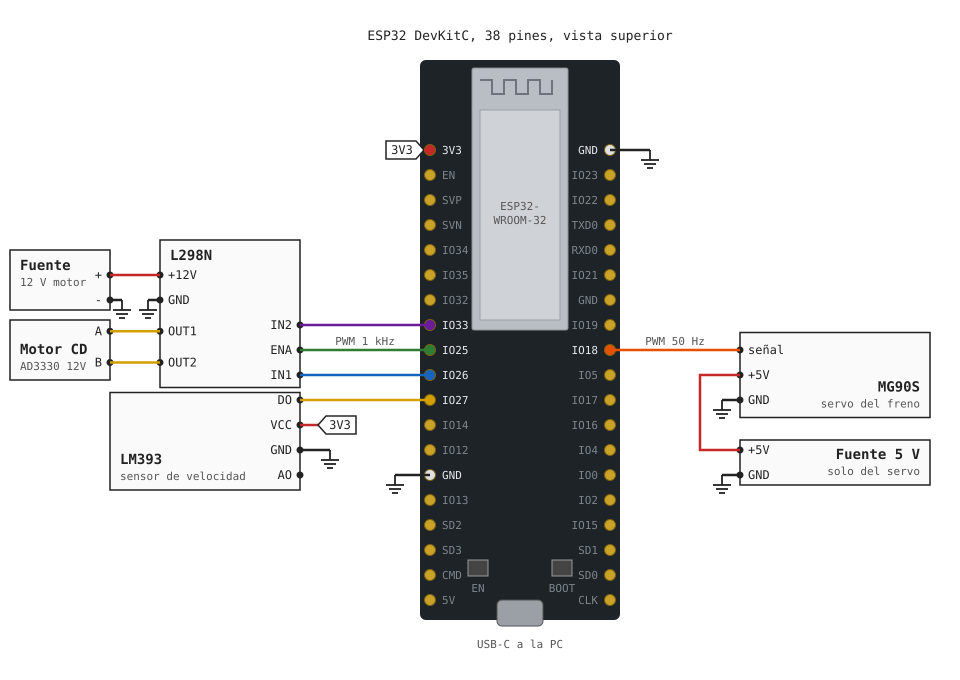

# Conexiones

Si se cambia un cable, cambiarlo también en `firmware/sdkconfig.defaults`.

| Componente | Modelo | Qué hace | Conexión al ESP32 |
|---|---|---|---|
| Microcontrolador | ESP32 DevKitC, 38 pines (ESP32-WROOM-32) | Mide, decide y registra; se comunica con la PC | USB a la PC: alimentación y serie a 115200 |
| Sensor de velocidad | LM393 Motor Speed Measuring Sensor Module | Horquilla óptica: da un pulso cada vez que pasa una ranura del disco | DO → **GPIO27**, VCC → **3V3** (no a 5 V), GND |
| Disco | Disco de 20 ranuras | Gira con el motor; sus ranuras dan 20 pulsos por vuelta | — |
| Freno | Servo MG90S con goma | El ángulo del brazo fija cuánto aprieta la goma contra el disco | Señal → **GPIO18** (PWM 50 Hz) |
| Fuente del servo | 5 V, 1 A o más | Alimenta el MG90S; el 5 V del USB no alcanza al frenar | GND común |
| Puente H | L298N | Entrega al motor la potencia de su fuente según el PWM | ENA → **GPIO25** (PWM 1 kHz, sin jumper), IN1/IN2 → **GPIO26**/**GPIO33** (sentido), GND común |
| Motor | 12VDC Miniature Motor (AD3330) | Acelera el disco antes de cada ensayo | A través del L298N (OUT1/OUT2) |
| Fuente del motor | 12 V | Alimenta el motor a través del L298N (+12V/GND) | GND común |

Todos los GND van unidos. Si el motor gira al revés, intercambiar OUT1 y OUT2.

