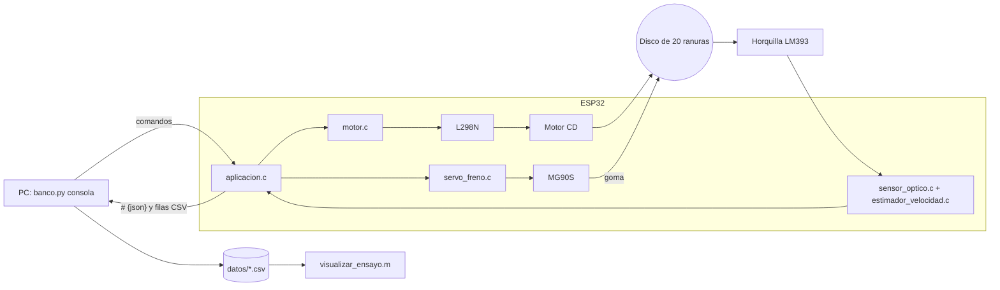

# Flujo del sistema

## Firmware

| Módulo | Función |
|---|---|
| `aplicacion.c` | Bucle principal: comandos, ensayo automático, calibración, registro periódico y cierre |
| `comandos.c` | Interpreta las líneas recibidas (`FRENO 150`, `CAL +`, ...) |
| `sensor_optico.c` / `estimador_velocidad.c` | Interrupción por flanco de la salida DO del LM393 (uno por ranura); RPM con el tiempo de la última vuelta |
| `servo_freno.c` / `conversion_freno.c` | Grados ↔ pulsos dentro del recorrido calibrado |
| `motor.c` | PWM del L298N y corte por límite de impulso |
| `reloj_registro.c` | Una muestra por periodo; cuenta las perdidas sin inventarlas |
| `protocolo_serial.c` | Cola de transmisión; nunca bloquea la adquisición |
| `hardware.c` | Carga y valida pines y calibración antes de tocar periféricos |
| `pid_controller.c` | PID discreto (Tarea 2); aún no se usa en el registrador |

## Ensayo automático

1. `ensayo 60 152 300` → el motor arranca al 60 % (exige freno liberado).
2. Cuando la velocidad lleva 0,5 s sin subir más de 2 %, se corta el motor y empieza el registro (`t = 0`).
3. A los 300 ms se aplica el freno a 152°.
4. Una fila cada 20 ms hasta 10 s o `parar`; al cerrar se libera el freno.
5. La consola guarda `datos/<nombre>_NN.csv` y `.json` y muestra el resumen.

## Datos

`tiempo_ms,freno_deg,velocidad_rpm`: tiempo del ESP32 desde el corte del motor, ángulo ordenado
(no medido) y velocidad. `nan` mientras no hay dos pulsos; `0` tras 100 ms sin pulsos (menos de 30 RPM). El `.json`
guarda la configuración efectiva, los eventos con su tiempo y el cierre (filas producidas,
enviadas y perdidas; `completo` indica que no faltó ninguna).

RPM = 60·10⁶ · N / (20 · suma de los últimos N intervalos en µs), con N = 20: medir una vuelta
completa cancela el espaciado desigual de las ranuras.

## Seguridad

El motor solo arranca con el freno liberado y se corta solo a los 15 s; el freno solo se mueve con
el motor cortado y dentro del recorrido calibrado; cualquier fallo de serie o de actuador corta el
motor y cierra la captura.
