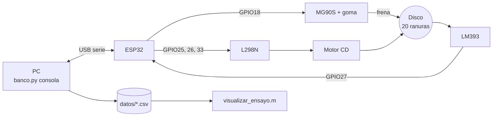
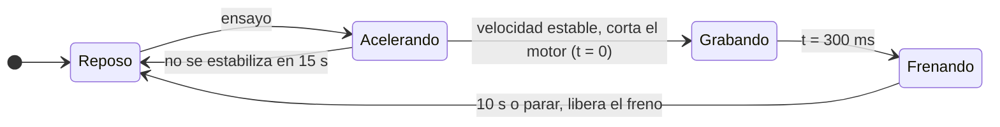

# Flujo del sistema

## Bloques

La consola manda comandos de texto y recibe dos tipos de línea: mensajes `# {json}` (estado,
eventos, cierre) y filas CSV mientras graba. Guarda cada captura en `datos/`.

| Firmware | Función |
|---|---|
| `aplicacion.c` | Bucle principal: comandos, ensayo automático, calibración y registro |
| `sensor_optico.c`, `estimador_velocidad.c` | Interrupción por ranura del LM393 y cálculo de RPM |
| `servo_freno.c`, `motor.c` | PWM del servo (50 Hz) y del L298N (1 kHz) |
| `protocolo_serial.c` | Cola de salida; la medición nunca espera a la serie |
| `pid_controller.c` | PID discreto de la Tarea 2; aún no se usa en el banco |

## Ensayo automático

1. `ensayo` arranca el motor al 60 % (exige el freno liberado).
2. Cuando la velocidad lleva 0,5 s sin subir más de 2 %, corta el motor y empieza a grabar. Con el
   mismo porcentaje, cada repetición parte de la misma velocidad.
3. A los 300 ms aplica el freno (153°, el máximo calibrado).
4. Una fila cada 20 ms hasta 10 s o `parar`; al cerrar libera el freno y la consola muestra el resumen.

## Datos y velocidad

`tiempo_ms,freno_deg,velocidad_rpm`: tiempo desde el corte del motor, ángulo **ordenado** al servo
(no medido) y velocidad. El `.json` de cada captura guarda la configuración, los eventos y si llegó
completa.

RPM = 60·10⁶ · 20 / (20 · tiempo de las últimas 20 ranuras en µs), o sea el tiempo de una vuelta
completa: así el espaciado desigual de las ranuras no aparece como ruido. `nan` hasta tener dos
flancos; `0` bajo 30 RPM (100 ms sin flancos).

## Seguridad

El motor solo arranca con el freno liberado y se corta solo a los 15 s; el freno solo se mueve con
el motor cortado y dentro de 45..153°; un fallo de serie o de actuador corta el motor y cierra la
captura.
