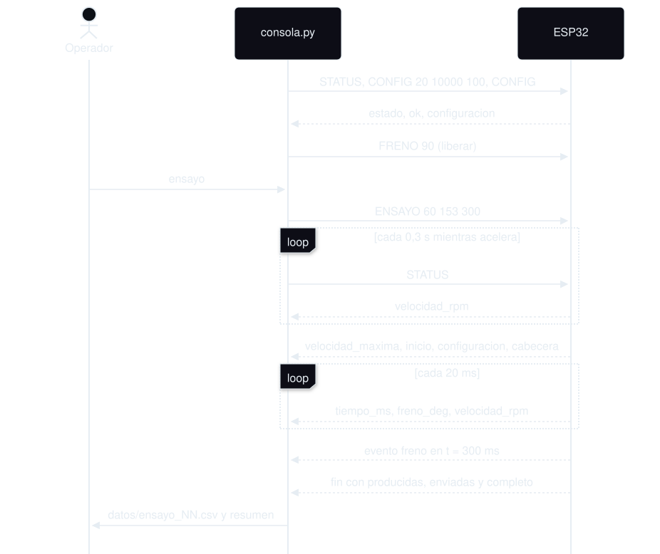

# Flujo del sistema

Cómo funciona el banco de punta a punta: qué bloque hace qué, en qué contexto corre cada parte del
firmware, cómo avanza un ensayo y qué se guarda. El cableado está en [conexiones](02_conexiones.md)
y la forma de correrlo en [ejecución](01_ejecucion.md).

## Índice

| Sección | Qué cubre |
|---|---|
| [1. Diagrama de bloques](#1-diagrama-de-bloques) | PC, ESP32 y banco; qué módulo del firmware maneja cada pieza |
| [2. Contextos de ejecución](#2-contextos-de-ejecución) | Interrupción, temporizador y tareas; por qué nada espera a la serie |
| [3. Ensayo automático](#3-ensayo-automático) | Estados de `ENSAYO`, de la aceleración al cierre |
| [4. Una sesión de consola](#4-una-sesión-de-consola) | Mensajes entre la consola y la placa durante un ensayo |
| [5. Medición de velocidad](#5-medición-de-velocidad) | Del flanco del LM393 a las RPM, y sus límites |
| [6. Datos](#6-datos) | Columnas del CSV y contenido del JSON |
| [7. Seguridad](#7-seguridad) | Qué impide cada orden peligrosa |

## Decisiones

| # | Decisión | Sección | Impacto |
|---|---|---|---|
| [D1](#d1) | Las RPM se calculan con el tiempo de la última vuelta completa | 5 | El espaciado desigual de las 20 ranuras no aparece como ruido |
| [D2](#d2) | La adquisición nunca espera a la UART | 2 | Una fila por periodo aunque la PC lea lento; una cola llena cierra el ensayo como incompleto |
| [D3](#d3) | El ensayo corta el motor cuando la velocidad deja de subir | 3 | Cada ensayo empieza desde la velocidad máxima de ese porcentaje, repetible |
| [D4](#d4) | El freno solo se mueve con el motor cortado | 7 | El freno es unilateral: nunca compite contra el motor |
| [D5](#d5) | Pines y calibración viven en `firmware/sdkconfig.defaults` | 1 | Una compilación limpia ya tiene el banco vigente; `CAL` solo informa qué copiar |

Los diagramas salen de [`diagramas/src/`](diagramas/src) y se regeneran con `python banco.py diagramas`.

## 1. Diagrama de bloques

La consola envía comandos de texto por USB y recibe dos tipos de líneas: mensajes `# {json}`
(estado, eventos, configuración, cierre) y filas CSV durante una captura. Guarda cada captura en
`datos/`, que MATLAB analiza después.

| Módulo | Función |
|---|---|
| `aplicacion.c` | Bucle principal: comandos, ensayo automático, calibración, registro y cierre |
| `comandos.c` | Interpreta cada línea recibida (`FRENO 150`, `CAL +`, ...) |
| `sensor_optico.c` / `estimador_velocidad.c` | Interrupción por flanco del LM393 y cálculo de RPM ([D1](#d1)) |
| `servo_freno.c` / `conversion_freno.c` | Grados ↔ microsegundos dentro del recorrido calibrado |
| `motor.c` | PWM del L298N y corte por límite de impulso |
| `reloj_registro.c` | Una muestra por periodo; cuenta las perdidas sin inventarlas |
| `protocolo_serial.c` | Cola de transmisión y lectura de comandos ([D2](#d2)) |
| `hardware.c` | Carga y valida pines y calibración antes de tocar periféricos |
| `pid_controller.c` | PID discreto de la Tarea 2; todavía no se ejecuta en el banco |

**D5. Pines y calibración en `firmware/sdkconfig.defaults`.** `banco.py` regenera la
configuración cuando ese archivo cambia, así que editarlo y `flashear` basta. `menuconfig` sirve
para probar algo sin tocar el archivo.

## 2. Contextos de ejecución

| Contexto | Cuándo corre | Qué hace |
|---|---|---|
| ISR de GPIO27 | En cada flanco de bajada del LM393 | Guarda la hora del flanco en el estimador; no calcula ni transmite |
| `esp_timer` | Cada `periodo_ms` (20 ms) | Solo avisa a `app_main` que toca una muestra |
| `app_main` (prioridad 4) | Bucle cada 1 ms | Vigila el motor, el ensayo y la calibración; toma la muestra; atiende comandos |
| `asm2_tx` (prioridad 3) | Cuando hay líneas en la cola | Único escritor de la UART |

**D2. La adquisición nunca espera a la UART.** Cada línea entra a una cola de 64 sin
bloquear. Si la cola se llena, el ensayo se cierra con `completo: false` en lugar de retrasar las
muestras; el cierre informa filas producidas, enviadas y periodos perdidos.

## 3. Ensayo automático

`ENSAYO 60 153 300` (en la consola, `ensayo`) exige el freno liberado y `CONFIG` previo. El tiempo
`t = 0` del CSV es el instante en que se corta el motor; el freno se aplica en `t = 300 ms`, así el
CSV tiene giro libre antes del escalón, como pide `visualizar_ensayo.m`.

**D3. Se corta el motor cuando la velocidad deja de subir** (0,5 s sin subir más de
2 %). Con el mismo porcentaje de motor, cada repetición arranca desde la misma velocidad, que es la
condición inicial equivalente que pide la comparación final. Si no se estabiliza en 15 s, el motor
se corta y no se graba nada.

## 4. Una sesión de consola

Al conectar, la consola pide estado y configuración y libera el freno. Mientras el motor acelera
sondea `STATUS` para mostrar las RPM en vivo; durante la captura muestra la última fila en una
línea que se reescribe. Las filas y los mensajes JSON no se imprimen: se guardan.

## 5. Medición de velocidad

El *LM393 Motor Speed Measuring Sensor Module* es una horquilla óptica: cada ranura del disco deja
pasar la luz y el comparador LM393 da un flanco en DO. Se cuenta un solo flanco (bajada) por ranura.

**D1. RPM con el tiempo de la última vuelta.**

RPM = 60·10⁶ · N / (20 · suma de los últimos N intervalos en µs), con N = `ASM_VENTANA_PULSOS` = 20.

Medir una vuelta completa cancela que las ranuras no estén perfectamente espaciadas; el costo es
el retardo de media vuelta (unos 100 ms a 300 RPM). Para el PID puede bajarse N.

| Límite | Valor | Por qué |
|---|---|---|
| Sin dato | `nan` | Aún no hay dos flancos |
| Velocidad mínima | 30 RPM | Con 100 ms sin flancos se registra 0 (timeout de `CONFIG`) |
| Rebote del comparador | < 200 µs se descarta | Equivale a 15 000 RPM, muy por encima del banco |

## 6. Datos

Cada captura produce `datos/<nombre>_NN.csv` y su `.json`.

| Columna | Unidad | Qué es |
|---|---|---|
| `tiempo_ms` | ms | Reloj del ESP32 desde el corte del motor |
| `freno_deg` | grados | Ángulo **ordenado** al servo; no hay medición de posición ni de fuerza |
| `velocidad_rpm` | RPM | Sección 5 |

El `.json` guarda la configuración efectiva de la placa, los eventos con su tiempo (motor, freno,
estado del sensor) y el cierre: filas producidas y enviadas, periodos perdidos y `completo`. Los
datos crudos no se editan.

## 7. Seguridad

**D4. El freno solo se mueve con el motor cortado.** El freno no puede acelerar el
disco; frenar con el motor encendido solo calienta ambos.

| Orden | Se rechaza si |
|---|---|
| `MOTOR`, `ENSAYO` | El freno no está liberado, falta `CONFIG` o hay una captura |
| `FRENO` | El motor está encendido o el ángulo sale de 45..153° |
| `CAL ...` | El motor está encendido, hay una captura o el pulso sale de 1000..2200 µs |
| `CONFIG` | El motor está encendido o hay una captura |

Además, el motor se corta solo a los 15 s continuos; un fallo de serie o de actuador corta el
motor y cierra la captura; y tras 15 s sin órdenes `CAL` se apaga el PWM del servo.
