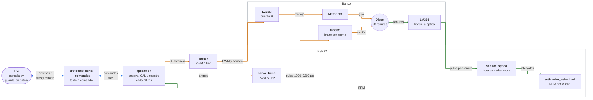
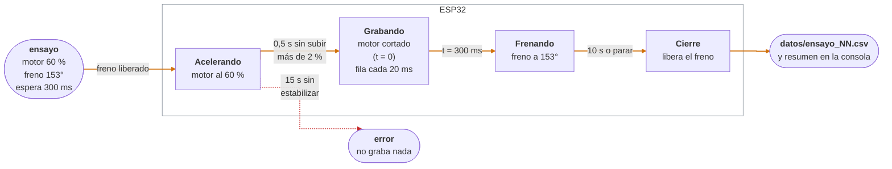

# Flujo del sistema

Cómo viaja un comando desde la PC hasta el disco y de vuelta a un CSV, y en qué orden leer los
archivos para entenderlo.

## Bloques

Azul: comunicación con la PC. Naranja: actuación. Verde: medición (realimentación).

## Orden de lectura

1. **Cómo se corre todo**: `banco.py`, de `main` hacia arriba (`buscar_idf` → `entorno_idf` →
   `idf_py` → `detectar_puerto`).
2. **Qué hardware cree el firmware que tiene**: `firmware/sdkconfig.defaults` (valores reales), luego
   `firmware/src/hardware.c` (los carga y los valida).
3. **El corazón**: `firmware/src/aplicacion.c`, en este orden:
   1. `app_main` (al final): el bucle de 1 ms que vigila, muestrea y lee comandos.
   2. `ejecutar_comando`: qué hace cada comando y qué bloqueos de seguridad aplica.
   3. `iniciar_ensayo_automatico` y `vigilar_ensayo_automatico`: el ensayo (diagrama abajo).
   4. `iniciar_registro` → `adquirir_muestra` → `terminar_registro` → `intentar_cierre`: una captura.
   5. `ejecutar_calibracion` y `vigilar_calibracion`: los comandos `CAL`.
4. **Cómo se mide la velocidad**: `firmware/src/sensor_optico.c` (interrupción por ranura) y
   `firmware/src/estimador_velocidad.c` (RPM con la última vuelta).
5. **Cómo se mueven los actuadores**: `firmware/src/servo_freno.c` con `conversion_freno.c`, y
   `firmware/src/motor.c`.
6. **Cómo sale todo por la serie**: `firmware/src/protocolo_serial.c`.
7. **El lado de la PC**: `herramientas/consola.py`, clase `Banco`: `traducir` (alias → comandos),
   `leer` (hilo que recibe), `mensaje_json` (qué hace con cada mensaje); luego `Captura` (escribe el CSV).
8. **Lo que viene**: `firmware/include/pid_controller.h` y `firmware/src/pid_controller.c`.
9. **Cómo se prueba sin placa**: `firmware/tests/test_registrador.py` y los escenarios de
   `firmware/tests/pruebas_host.c`, que describen el comportamiento esperado de cada comando.

## Ensayo automático

Con el mismo porcentaje de motor, cada repetición parte de la misma velocidad: el motor se corta
cuando la velocidad deja de subir, no a un tiempo fijo.
